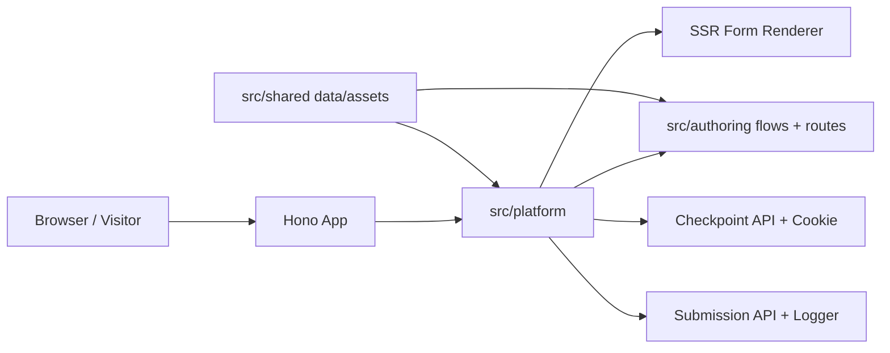

# instant-forms

Ultra-fast Bun + Hono + TypeScript progressive lead forms. The first flow families are Spanish auto and home insurance for Seguros Aseguranza, rendered from authored public route folders such as `/auto/tn` and `/hogar/tx`, with independent generic flows at `/auto` and `/hogar`.

## Purpose

This repository owns the full local runtime for routed, checkpointed, conversion-focused forms: Hono routes, typed form flows, validation, server-rendered HTML, inline client behavior, tests, and documentation.



## Belongs Here

- Application code under `src/`.
- Fast behavior tests under `tests/unit/`.
- Browser layout and interaction tests under `tests/ui/`.
- Repository-level docs, commands, and contributor guidance.

## Does Not Belong Here

- External CRM, database, or webhook integrations until explicitly introduced.
- Generated build artifacts or downloaded browser binaries.
- Secrets, API keys, or machine-specific local configuration.

## Change Safely

Run the smallest useful check first, then broaden:

```bash
bun run typecheck
bun test
bun run test:ui
git diff --check
```

Use `bun run test:ui:update` only when visual changes are intentional.

## Quickstart

Install dependencies:

```bash
bun install
```

Run the app:

```bash
bun run dev
```

Open `http://localhost:3000/`.

Build production form HTML:

```bash
bun run build:forms
```

The build writes minified route HTML into `/_dist/forms`. Each step page still ships CSS and the minimum active-step JavaScript inline for speed, but production requests read the prebuilt shell and only inject the request-specific checkpoint config from the HttpOnly cookie. The build also emits a hashed, cacheable transition JS asset under `/_dist/forms/_instant/forms/<hash>/transition.js`; after the first page settles, the browser loads that static asset so approved next/back transitions can swap step HTML without a full document load. Development keeps readable CSS/JS and uses the same active-step-only SSR shape.

The Hono app applies origin-level text compression with `hono-compress`, preferring Brotli and falling back to gzip for large HTML, JavaScript, JSON, CSS, and plain-text responses. Cloudflare Brotli/compression can remain enabled as an outer edge optimization, but form pages no longer rely on the CDN or Railway edge to satisfy browser compression checks.

## Project Structure

```text
.
├── README.md
├── AGENTS.md
├── index.ts
├── package.json
├── playwright.config.ts
├── src
│   ├── authoring
│   ├── platform
│   └── shared
└── tests
    ├── unit
    └── ui
```

Every source and test folder has its own `README.md` describing ownership and safe-change rules. Diagrams are included only where they clarify architecture or flow.

## Routes

| Route | Purpose |
|---|---|
| `GET /` | Shared single-CTA welcome, then product selection at `/producto`. |
| `GET /producto` | Auto/home selection; choosing an option automatically advances. |
| `POST /producto` | Confirms the selected product's welcome checkpoint, then resumes that generic flow without another welcome. |
| `GET /auto`, `GET /hogar` | Resume the independent generic product flow, starting at `/inicio` for a new visitor. |
| `GET /auto/:stepSlug`, `GET /hogar/:stepSlug` | Generic guarded steps and `/gracias`, without a state in the path. |
| `GET /auto/:state`, `GET /hogar/:state` | Resume an authored state flow. A valid but unauthored state redirects to the generic welcome with `?state=XX`. |
| `GET /auto/:state/:stepSlug`, `GET /hogar/:state/:stepSlug` | Existing dedicated state steps keep their original routes. |
| Unknown product/state paths | Invalid state codes and unknown generic paths return 404. |
| `GET /__preview/auto/tn/:stepSlug` | No-store preview mirror for public form step visual iteration. |
| `GET /_instant/scripts/:scriptKey.js` | Allowlisted first-party proxy for selected third-party scripts. |
| `GET /~partytown/*` | Partytown worker/runtime assets used after the small bootstrap has been inlined. |
| `POST /api/forms/:routeKey/checkpoints` | Validates one answer, writes the checkpoint cookie, and returns the next URL. |
| `POST /api/forms/:routeKey/submissions` | Validates, posts downstream, and logs completed submissions. |
| `POST /api/forms/:routeKey/native-submissions` | Validates native TrustedForm submissions, posts downstream, and redirects to the authored post-submit page. |

Unavailable public routes use author-controlled title, message, CTA, and status from `src/authoring/routes/registry.ts`.

Public page URLs and their preview mirrors accept trailing slashes. GET/HEAD requests redirect to the same path without trailing slashes using a no-store `302`, preserving query parameters before normal resume/guard handling. For example, `/auto/` redirects to `/auto`, which then resumes the generic auto flow. The site root `/`, API/proxy/asset URLs, and POST requests are not normalized.

## Form Flow

Auto- and home-insurance flows are generated from the product-authored area filters in `src/authoring/flows/auto/registry.ts` and `src/authoring/flows/home/registry.ts`. Those filters must use codes from `US_STATES`, but only listed states are mounted under `/auto/{state}` and `/hogar/{state}`. Both products are built with the typed DSL in `src/platform/flow/dsl/`. Public route placement lives in `src/authoring/routes/registry.ts`. Runtime identity comes from that route mount, so `/auto/tn` uses the encoded route key `auto_tn` and `/hogar/tx` uses `hogar_tx`.

Generic flows are authored separately in `src/authoring/flows/generic.ts`, using `esGenericAutoInsuranceTemplate` and `esGenericHomeInsuranceTemplate`. They share product questions, welcome styling, consent and delivery mapping with the state templates, but have their own contracts and route keys (`auto`, `hogar`), checkpoint cookies and post-submit state. They require a confirmed state and never switch to a dedicated state flow, even when one exists. Generic templates omit the area badge through `page.presentation.showAreaBadge: false`.

Generic auto order: `/auto/inicio`, `/auto/estado-donde-vive`, `/auto/tiene-licencia`, `/auto/tiene-seguro`, `/auto/titulo-limpio`, `/auto/autos-a-asegurar`, `/auto/nombre`, `/auto/apellido`, `/auto/telefono`, `/auto/consentimiento`, `/auto/gracias`.

Generic home order: `/hogar/inicio`, `/hogar/estado-de-la-propiedad`, `/hogar/dueno-o-renta`, `/hogar/tipo-de-propiedad`, `/hogar/uso-de-propiedad`, `/hogar/tiene-seguro-de-hogar`, `/hogar/edad-de-la-vivienda`, `/hogar/edad-del-techo`, `/hogar/nombre`, `/hogar/apellido`, `/hogar/telefono`, `/hogar/consentimiento`, `/hogar/gracias`.

For example, `/auto/fl` redirects to `/auto/inicio?state=FL`. The state hint is validated against the state autocomplete source, displayed for confirmation, and preserved across navigation/refresh without becoming a checkpoint answer until confirmed. A saved answer takes precedence over the hint. Attribution parameters pass through the shared welcome/product selection and existing attribution capture stays unchanged.

Generic flows reuse the shared PostHog defaults; GTM and direct Meta CAPI are disabled by default. No state-specific Meta Pixel ID is inherited; optionally author `metaPixelId` on either generic template instantiation in `generic.ts`. The product selector submits its ordinary same-origin form automatically 180 ms after selection, matching choice-step timing; `Continuar` remains a manual/no-JavaScript fallback. Neither `/` nor `/producto` emits analytics events. The former `/cotizar` and `/cotizar/producto` URLs are removed and return 404 without redirects.

Reusable flow shapes live in `src/authoring/templates/` and use `defineFormTemplate(...)`. A template declares a Zod `variables` contract and exposes `.create(input)`, which validates required, optional, and unknown variables before returning a normal `InstantForm` through `defineFormFlow(...)`. Each authored auto state is currently an instantiation of the reusable Spanish auto-insurance template; each authored home state is an instantiation of the reusable Spanish home-insurance template.

Each flow declares a `locale`, an explicit `ui` copy block for platform-owned labels, progress text, modal copy, validation/failure messages, and native error pages, plus a neutral `postSubmit` page for the successful post-submission destination. There is no hidden Spanish fallback: a new language is authored by creating a flow whose step copy, `ui` copy, and `postSubmit` copy are in that language.

Each flow also declares a Zod-backed `contract` with `context`, `answers`, and `payload` schemas. Authored business context such as `areaCode: "TN"`, `areaName: "Tennessee"`, and `product: "auto_insurance"` lives in `context`; answer-producing steps must use keys declared in `contract.answers`; and `payload` declares the downstream HTTPS URL, method, encoding, and a typed `mapping` built from `{ context, answers, submission, request, cookies, browser }`. JSON delivery payloads can contain structured objects, booleans, arrays, and nested data; `form_urlencoded` delivery stays string-only. Valid final submissions are posted to the authored downstream endpoint before the visitor sees success. Supported step kinds are `choice`, `text`, `phone`, `autocomplete`, `interstitial`, and `trusted_form_consent`.

Dynamic authoring is step-level: a step is either static, or it declares one dependency list and one resolver for its dynamic display/body props. Nested field-level `resolve(...)` calls are intentionally rejected so it is always clear which upstream answers a dynamic step needs. Page-level presentation can set a desktop-only form height with `page.presentation.desktopHeightPx`; mobile continues to use the fixed viewport-height layout. Static `presentation.chrome` can hide the form chrome with `"hidden"` or `"hidden_on_mobile"`; TrustedForm substep-specific chrome overrides live under `substeps.review.presentation` or `substeps.consent.presentation`, not inside the dynamic review/consent copy. TrustedForm review and consent prose can use safe Markdown through `md(...)` / `markdown(...)` in that resolver. Submitted values and native controls stay plain text: use `text(...)` for resolver-produced field values and ordinary strings for button labels, placeholders, keys, and slugs. Markdown is rendered on the server with raw HTML escaped, and the browser receives only sanitized HTML in its client config.

Current auto visible order:

1. `belongs_to_state`
2. `residence_state` when `belongs_to_state` is `no`
3. `has_license`
4. `has_insurance`
5. `is_clean_title`
6. `number_of_registered_cars`
7. `matching_offer`
8. `first_name`
9. `last_name`
10. `phone_number`
11. `trustedform_consent`

The `matching_offer` step is routed and checkpointed, but not counted in `Paso X de Y`. Its success copy uses separate colored lines so each phrase can use a distinct brand color.

Current home visible order:

1. `property_in_state`
2. `property_state` when `property_in_state` is `no`
3. `ownership_status`
4. `property_type`
5. `property_use`
6. `has_home_insurance`
7. `house_age_years`
8. `roof_age_years`
9. `matching_offer`
10. `first_name`
11. `last_name`
12. `phone_number`
13. `trustedform_consent`

The `trustedform_consent` step is authored as explicit `review` and `consent` substeps on one route and one native form. `review` owns the confirmation title, optional description, continue label, and ordered field list; fields are tagged for TrustedForm only when the author adds a `trustedForm.role`. `consent` owns the final title, optional description, Markdown disclosure, checkbox label, and submit label. The step executes the TrustedForm Certify SDK only when mounted. Tennessee uses the selected-script proxy at `/_instant/scripts/trustedform.com/tfc.js`, so browsers request the SDK through the first-party domain whether the authored delivery mode is `main_thread` or `partytown`. Transition assets may register the TrustedForm behavior module ahead of time, and the runtime may preload same-origin TrustedForm assets before the consent step, but preloading must not execute Certify or create a certificate. The consent checkbox substep is gated behind TrustedForm readiness.

## Tracking

Current state-specific and generic auto/home flows do not load GTM, its Partytown runtime, or browser Meta Pixel tags. They do not initialize or push to `dataLayer`, even if another script created it. Shared client tracking metadata (event definitions, context, server-event flags and Meta browser-ID capture) is independent of the optional GTM transport. Browser-only validation-error, submit-attempt and submit-error events have no delivery destination while GTM is disabled.

The GTM capability remains available through the typed `googleTagManager(...)` authoring preset and the templates' optional `gtmContainerId` variable. Only explicit GTM opt-in installs the first-party request shim, initializes `window.dataLayer`, inlines the Partytown bootstrap and loads GTM. It then pushes the existing authored lifecycle events. GTM preview/debug bootstrap scripts remain first-party proxied but run on the main thread. Pixel IDs are authored per product/area and exposed through event mappings, not hardcoded into a global container.

The optional `META_TEST_EVENT_CODE` is forwarded on authored Meta mappings and downstream conversion data; leave it unset for normal production traffic. Product/state pixel IDs remain in `autoMetaPixelIds` and `homeMetaPixelIds` beside flow generation. A configured pixel keeps `meta_conversion.enabled: true`, with the pixel ID, `Lead` name, submission event ID, source URL, IP, user agent, available `fbc`/`fbp`, and test code. This remains true even with all analytics delivery disabled. Generic flows have no pixel and send `meta_conversion.enabled: false` until explicitly configured. No access token is included in submissions.

Auto- and home-insurance flows require `LIDERNA_WEBLEADS_SUBMISSION_URL` before starting the server or building forms. It must be an absolute HTTPS URL and is authored into each template as the blocking downstream lead endpoint.

Current flows do not read `META_CONVERSIONS_ACCESS_TOKEN` into their defaults. Leaving this variable set does not enable direct Meta CAPI. The helper and optional template setting remain available, but require an explicit `metaConversionsAccessToken` and pixel ID. Final `Lead` conversion responsibility and the downstream payload contract remain unchanged.

To deliberately re-enable either integration on an individual authored flow, pass its optional settings through `createAutoInsuranceFlow(...)`, `createHomeInsuranceFlow(...)`, or the generic template's `.create(...)`. For example, add these fields to the chosen flow's existing variables:

```ts
gtmContainerId: "GTM-EXAMPLE", // Optional browser/GTM delivery only.
metaConversionsAccessToken: process.env.META_CONVERSIONS_ACCESS_TOKEN, // Optional direct progress CAPI; also requires metaPixelId.
```

These settings are independent; omit either to keep that delivery path disabled. Keep credentials server-side and rebuild production form assets when changing tracking configuration. No dependency or proxy route needs to be restored.

Server-side tracking destinations are composed as explicit authored effects. Meta CAPI and PostHog use the same non-blocking server callback path, so adding a destination does not change the visitor response path. When `POSTHOG_PROJECT_API_KEY` is set, auto and home flows send server-observed funnel events to PostHog's Capture API for pageviews, pageleaves, form views, step views, step answers, TrustedForm substep views, and submit success. Set `POSTHOG_API_HOST` to override the default `https://us.i.posthog.com`. PostHog events use a shared visitor id and a shared session id stored in opaque platform cookies; their lifetimes are authored in the flow variables, currently 31,536,000 seconds for the visitor and 1,800 seconds for the session. Both values are 24-character alphanumeric NanoIDs and are only created when an authored server tracking effect needs them. PostHog payloads include route, form, step, request URL, session id, IP, user agent, captured attribution fields, and pageleave reason/duration when available, but they do not include raw answers, phone numbers, email, consent text, request cookies, authorization headers, or downstream delivery payloads.

Auto/home attribution hooks preserve `fbclid`, `source_channel`, `acquisition_channel`, and `platform` through shared entry/product selection and route redirects. Explicit valid query values override their corresponding saved cookies; omitted values retain saved attribution. With no saved classification the defaults are `unknown`/`organic`. A pixel ID does not imply paid traffic, and UTM values are not mapped. The hooks store `_fbc` as `fb.1.<timestamp>.<fbclid>` only for a new/missing click ID, with the existing 90-day lifetime. Pixel-configured flows still capture and forward browser IDs without loading a Pixel: existing `_fbp`/`_fbc` are retained, and the existing local `_fbp` creation behavior remains. After capture, the client may clean the visible step URL as usual.

## Selected Scripts

Selected third-party scripts are declared in `src/authoring/scripts/registry.ts` and served by an allowlisted proxy. The `gtm` entry maps `/_instant/scripts/gtm.js?id=GTM-XXXX&l=dataLayer` to Google Tag Manager. GTM/Google tag follow-up requests are routed through the first-party `/_instant/google-tags/proxy` allowlist by both the Partytown `resolveUrl` hook and a page-level request shim that rewrites main-thread DOM/request escape paths; the shim also exposes decoded upstream URLs to Google tag scripts that inspect their own `src`. The `tfc` entry maps short public query aliases (`f`, `t`, `s`) to the TrustedForm SDK parameters (`field`, `use_tagged_consent`, `sandbox`). Flow templates use `trustedFormCertify(...)` from `src/authoring/integrations/` to reuse the stable Certify field name, proxy URL, preload, execution, and readiness settings without repeating them in every flow. The proxies do not accept arbitrary URLs or forward visitor cookies. Selected script proxy responses use private browser-only caching, while follow-up proxy routes use `no-store`; Cloudflare should also bypass cache for `/_instant/scripts/*`, `/_instant/google-tags/proxy*`, and `/_instant/trustedform/proxy*` if a cache-everything rule is enabled. When Partytown delivery is used, the small `partytown.js` bootstrap is inlined into the page or dynamic initializer; larger worker files are still served from `/~partytown/` after startup. TrustedForm uses the Node fetch runtime because Bun 1.3.9 can hang on the TrustedForm CDN response while Node fetch resolves it normally.

## Checkpoints

Partial answers are saved in an HttpOnly opaque platform cookie with a deterministic `if_<hash>` name, a 7-day max age, `SameSite=Lax`, `Path=/`, and `Secure` on HTTPS. Post-submit state, the shared tracking visitor ID, and the shared tracking session ID use the same opaque naming strategy. Legacy explicit names such as `instant_forms_<routeKey>_answers`, `instant_forms_<routeKey>_post_submit`, and `instant_forms_visitor_id` are still read during migration, but new writes use only opaque names. Cookie values are base64url JSON and are sanitized before use.

Phone checkpoints preserve the visitor-visible value for resume. Final submissions normalize valid US numbers to E.164, for example `+16155551234`.

## Submissions

The client posts:

```json
{
  "trustedFormCertUrl": "https://cert.trustedform.com/454a35b802f3e7b63ffabb4efedb7c6ebe67886c",
  "answers": {
    "belongs_to_state": "yes",
    "has_license": "yes",
    "has_insurance": "no",
    "is_clean_title": "yes",
    "number_of_registered_cars": "1",
    "first_name": "Ana",
    "last_name": "Lopez",
    "phone_number": "+16155551234",
    "trustedform_consent": "accepted"
  }
}
```

Valid submissions are logged with `routeKey`, form/page names, `submittedAt`, the top-level `trustedFormCertUrl`, the typed delivery payload, and normalized answers. The Tennessee flow can submit without a TrustedForm certificate when `allowSubmitWithoutCert` is true. `matching_offer` is checkpoint-only and omitted from final `answers`; `trustedform_consent` checkpoints as `"accepted"` during the funnel but is stored on final submission as `{ consent: string, trustedform_certificate_url: string | null }`, where `consent` is the server-resolved plain text of the accepted disclosure.

Example logged delivery block:

```json
{
  "delivery": {
    "url": "https://example.test/webleads-v2",
    "method": "POST",
    "encoding": "json",
    "payload": {
      "id": "33333333-3333-4333-8333-333333333333",
      "area": "TN",
      "source_channel": "unknown",
      "acquisition_channel": "organic",
      "ingress_channel": "website",
      "first_name": "Ana",
      "type": "insurance_auto",
      "last_name": "Lopez",
      "phone_number": "+16155551234",
      "created_time": "2026-05-27T12:00:00.000Z",
      "state_code": "TN",
      "is_clean_title": "yes",
      "has_license": "yes",
      "has_insurance": "no",
      "number_of_registered_cars": "1",
      "meta_conversion": {
        "enabled": true,
        "pixel_id": "1465068051587670",
        "event_source_url": "https://dev3000.liderna.net/auto/tn/consentimiento",
        "event_id": "33333333-3333-4333-8333-333333333333",
        "event_name": "Lead",
        "fbp": "fb.1.1779717727926.wqp6t469ygm",
        "fbc": "fb.1.1779717727926.CLICK123"
      }
    }
  }
}
```

## Production Logging

The app emits structured JSON-line logs to stdout through the platform `eventLogger`. Every request receives an `X-Request-Id` response header, and the same `requestId` is included in related route, checkpoint, resolution, tracking callback, submission, and delivery logs.

Lead delivery is the critical production path. Each downstream attempt logs its status or network error, successful delivery logs `lead.delivery_succeeded`, and exhausted retries log `lead.delivery_failed` with `level: "error"` and `critical: true`. Because this project intentionally favors production diagnosis for costly lost-lead failures, successful and failed delivery logs include the normalized answers and full downstream delivery payload. Logs still avoid environment secrets, access tokens, authorization headers, and raw request cookies.

## Contributor Guidance

See `AGENTS.md` for coding-agent and contributor instructions, including instruction precedence, quality gates, and repository conventions.
