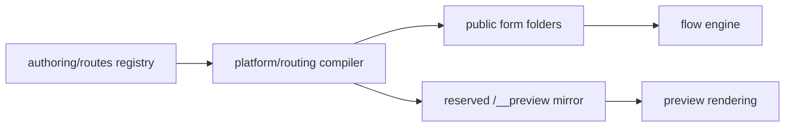

# src/platform/routing

## Purpose

`src/platform/routing/` compiles authored public form route folders into Hono handlers.

## Belongs Here

- The small public route DSL used by authoring.
- Hono registration for form page folders and nested route groups.
- Reserved preview mirror behavior for public form folders.
- Default form-folder fallbacks and authored group-level fallbacks.
- Unavailable-route actions with authored title, message, CTA, and status.
- Standalone `legal_page` actions and recognized-route validation for their return links.

## Does Not Belong Here

- Checkpoint or submission API route definitions.
- Area-specific flow content.
- Step validation, templates, or client-controller behavior.

## Change Safely

Keep this layer focused on URL placement. Flow semantics such as resume, guards, legacy slugs, and interstitial visibility should continue to come from the flow platform.

Each authored top-level folder and its preview mirror normalize trailing slashes on GET/HEAD requests before page handlers and fallbacks run. The no-store `302` preserves the query string and leaves checkpoint state untouched. Root `/`, API/proxy/asset paths, and non-navigation methods retain their existing behavior.

A route group may have an `index` flow or route action alongside children. Build entries include index flows, with dedicated child routes registered first. Generic state fallback actions preserve attribution and add a state hint. Optional `queryPrefill` mappings are restricted to autocomplete steps; they are validated as display-only hints, never merged into checkpoint answers or route guards.

Quote entry actions render the shared welcome/product selector. The selector's same-origin POST confirms only the chosen flow's welcome checkpoint and redirects to that flow's normal resume route. It does not copy state-flow cookies or save a suggested state.

Legal page actions serve authored draft documents independently of checkpoint state and tracking. Their preview mirrors and trailing-slash behavior use the same registry as other public pages. `returnTo` is restricted to recognized same-origin quote/form paths with supported attribution parameters and the state hint; legal loops and unrelated endpoints fall back to `/`. Visiting a document does not mutate cookies or bypass guards on the destination.
